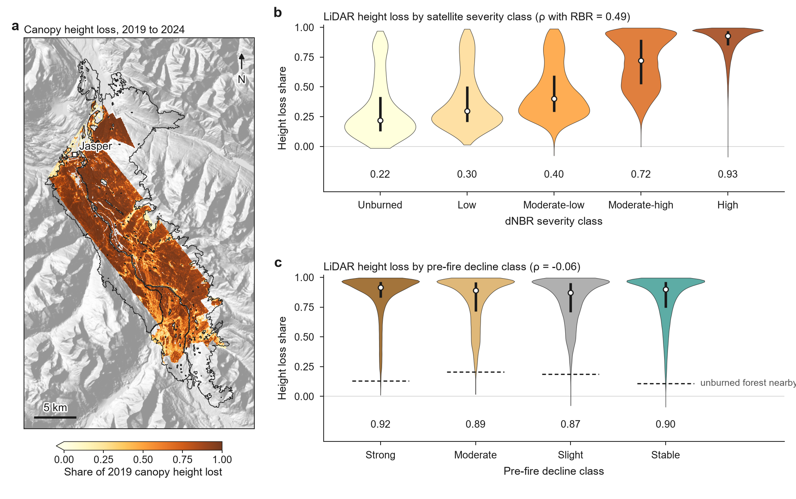

# jasper-fire-severity

Burn severity, pre-fire forest decline and canopy loss for the 2024 Jasper wildfire, from Sentinel-2, Landsat and 1 m airborne LiDAR. Everything runs on open data and reads only the part of each file it needs.

**Status: descriptive results done.** Burn severity from Sentinel-2, canopy loss from LiDAR, the pre-fire decline map and their comparison are in place. The modelling in "Next" is not done.

## The question

Mountain pine beetle killed much of the lodgepole pine around Jasper in the years before the fire. Did the beetle-killed stands burn more severely than the stands that were still green? Federal reports name the dead pine as one factor in how fast the fire spread. This project looks at severity, pixel by pixel, with public data.

## What it found so far


*(a) dNBR severity classes inside the fire perimeter. (b) Change in summer NDMI of conifer forest between 2013–15 and 2021–23. (c) Mean summer NDMI per year for four classes of that change; grey bands mark the two periods compared. (d) Relativized burn ratio by class: violins show all pixels, bars the interquartile range, dots and numbers the median. Maps are drawn over shaded relief from the 30 m national terrain model. A vector copy is in `docs/figure1.pdf`.*

**1. Almost two thirds of the fire burned at high severity.**

From Sentinel-2 scenes on 2024-07-07 and 2024-09-05 at 20 m. 98.9% of the perimeter had usable pixels in both scenes. The class breaks are the generic Key and Benson values and have not been calibrated on field plots from this fire, so read the classes as a ranking.

**2. The conifer forest lost moisture sharply in 2018, six years before it burned.**

One summer NDMI image per year from Landsat 8/9, 2013 to 2023, over the 28,525 ha that the 2010 land cover maps as conifer inside the perimeter. NDMI fell by more than 0.10 on 36% of that area and by more than 0.05 on 56%. Among declining pixels where the year is known, 2018 was the year of the largest drop on 47% of the area. That timing fits the outbreak Parks Canada reported, but the map has not been checked against field data, and the 2023 values are also lower in the stands that did not decline, which points to drought that year.

**3. Stands that had declined did not burn more severely than stands that had not.**

| Pre-fire NDMI change | Area (ha) | Pre-fire NBR | dNBR | RBR | High severity |
|---|---:|---:|---:|---:|---:|
| Strong decline (below -0.10) | 10,140 | 0.31 | 0.74 | 0.57 | 69% |
| Moderate decline | 5,827 | 0.35 | 0.76 | 0.57 | 68% |
| Slight decline | 3,874 | 0.36 | 0.75 | 0.57 | 67% |
| Stable or gain (above -0.02) | 8,640 | 0.40 | 0.77 | 0.57 | 67% |

Medians per class. The rank correlation between NDMI change and RBR is 0.004 across 316,450 pixels. The declined stands started with less green canopy, so they had less to lose, yet the relative burn ratio is the same in all four groups.

This does not show that beetle kill had no effect. Most of the fire burned as a crown fire in extreme weather, so the satellite index is close to its ceiling everywhere and cannot separate degrees of "very severe". Dead pine may also have changed how fast the fire spread, which this index does not measure. And nothing here is adjusted for terrain or for the weather on the day each stand burned.

**4. LiDAR agrees with the satellite index, and also finds no difference between declined and stable stands.**



*(a) Share of the 2019 mean canopy height that was gone in October 2024, per 30 m cell, where both LiDAR surveys have data. (b) That share by dNBR severity class. (c) The same by pre-fire decline class; dashed lines are the medians in unburned conifer forest just outside the perimeter.*

Canopy height is the 1 m surface model minus the 1 m terrain model, read at full resolution for 2019 and 2024 and averaged to 30 m. Both surveys cover 66% of the fire, which leaves 16,577 ha of conifer forest to compare.

| dNBR class | Area (ha) | Median height loss |
|---|---:|---:|
| Unburned | 40 | 22% |
| Low | 196 | 30% |
| Moderate-low | 549 | 40% |
| Moderate-high | 3,399 | 72% |
| High | 12,392 | 93% |

The height loss rises step by step with the satellite class (rank correlation with RBR 0.49), so the two independent measurements tell the same story. That is a check on the dNBR classes that did not need field plots.

By decline class the median loss is 92%, 89%, 87% and 90%, from strong decline to stable, and the rank correlation with NDMI change is -0.06. So the second measure gives the same answer as the first: no meaningful difference. It also reaches a ceiling, because the fire took about 90% of the canopy height over most of the area (half of all cells lost between 77% and 96%).

Three things to keep in mind:

- A 1 m surface model sees foliage and branches much better than thin bare stems. A stand of standing burned trunks reads as a large height loss even though the trees have not fallen.
- Unburned forest next to the fire also shows a median loss of 13% between the surveys, from tree fall, a later survey date and differences in processing. Only 310 ha of it has data from both years, because the 2024 survey was flown over the burned area.
- The declined stands were the tall ones: median canopy height in 2019 was 15.5 m under strong decline and 9.7 m in stable stands. Decline class and stand structure are tangled together, which is why the next step is a model that includes both.

## Run it

```bash
pip install -e ".[dev]"
jasperfire perimeter      # fire perimeter from the National Burned Area Composite
jasperfire dnbr           # dNBR, RBR and severity classes as GeoTIFFs in out/
jasperfire beetle         # yearly Landsat NDMI and the change map (about 8 minutes)
jasperfire compare        # severity by decline class
jasperfire canopy-loss    # LiDAR canopy height loss for the whole fire (about 6 minutes)
jasperfire figures        # the figures above, into docs/
jasperfire canopy --lon -118.0989 --lat 52.8466    # LiDAR canopy cover in one 500 m window
```

Every step reads only the window it needs from cloud-hosted files. Nothing large is stored apart from the burned-area shapefiles, though `canopy-loss` streams several gigabytes of LiDAR.

## Data

| Data | Source | Resolution | Checked |
|---|---|---|---|
| Fire perimeter | National Burned Area Composite 2024, fire `2024_451`, 31,645 ha | vector | yes |
| Optical imagery | Sentinel-2 L2A on Earth Search (STAC, cloud-optimized GeoTIFF) | 10–20 m | yes |
| LiDAR before the fire | CanElevation HRDEM, Jasper Park 2019 | 1 m | yes |
| LiDAR after the fire | CanElevation HRDEM, Jasper 2024 and Jasper 2025 | 1 m | yes |
| Pre-fire decline | Landsat 8/9 Collection 2 Level-2 on the Planetary Computer, 2013–2023 | 30 m | yes |
| Conifer mask | Land Cover of Canada, 2010 edition | 30 m | yes |
| Earlier fires | National Burned Area Composite, 2013–2023 (4.6 ha inside the perimeter) | vector | yes |
| Beetle survey | No open spatial layer found for inside the park | – | no |

Alberta publishes its beetle aerial surveys for provincial land, not for the national park, so the decline map here stands in for a survey layer. Checking it against Parks Canada's own survey data is still to do.

No open sub-metre imagery of this fire was found. Maxar's open data programme released imagery for the 2023 Kelowna and Northwest Territories fires and the 2025 Los Angeles fires, but not for Jasper. The 1 m LiDAR fills that gap here.

## Next

1. Build a pixel table with slope, aspect, elevation and 2019 canopy height, and model severity with spatial block cross-validation (`jasperfire.blocks`), so the test areas are not next to the training areas. This is what can separate beetle decline from stand structure.
2. Estimate the day each stand burned from active-fire detections and add that day's weather.
3. Ask Parks Canada for the beetle survey polygons and check the decline map against them.
4. Follow early regrowth with the 2025 LiDAR and the 2025–2026 imagery.

## Tests

```bash
ruff check .
pytest -q
```

The 27 tests run offline. They cover the index maths, reflectance scaling, cloud masking, yearly compositing, scene choice, canopy height and cover per cell, the block split and the comparison table.

## Credits

Contains information licensed under the Open Government Licence – Canada (NBAC, CanElevation, MRDEM, Land Cover of Canada), modified Copernicus Sentinel data, and Landsat data from the U.S. Geological Survey.
