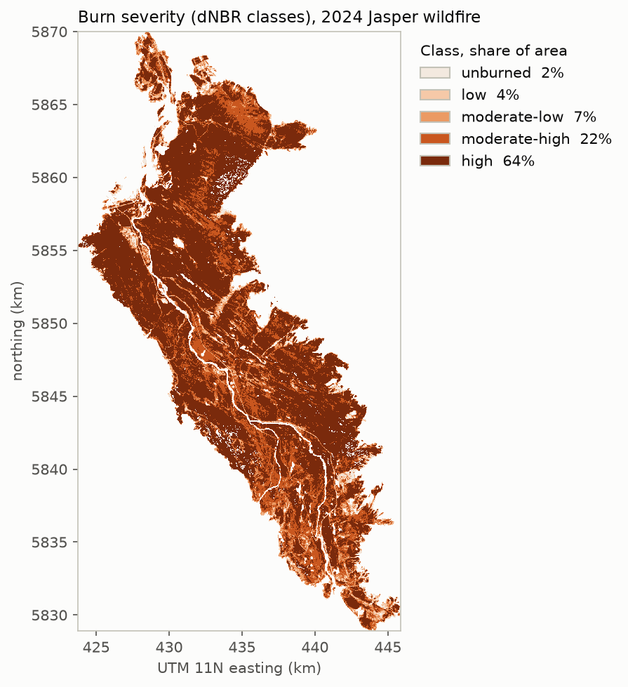
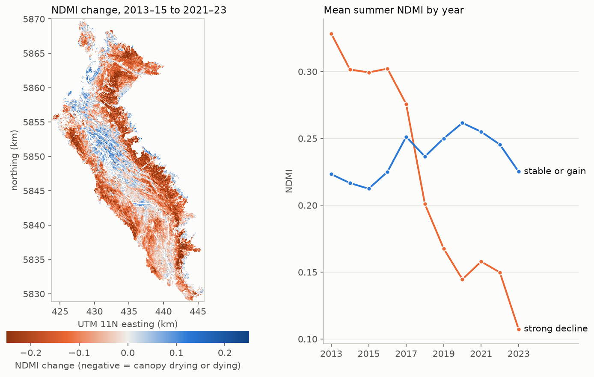
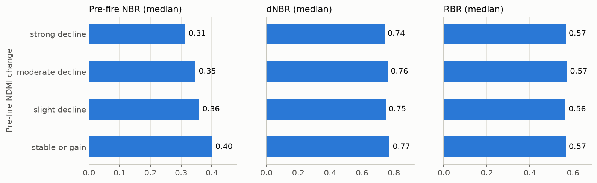

# jasper-fire-severity

Burn severity, pre-fire forest decline and canopy loss for the 2024 Jasper wildfire, from Sentinel-2, Landsat and 1 m airborne LiDAR. Everything runs on open data and reads only the part of each file it needs.

**Status: first pass done.** Burn severity, the pre-fire decline map and a first comparison are in place. The comparison is descriptive; the modelling in "Next" is not done.

## The question

Mountain pine beetle killed much of the lodgepole pine around Jasper in the years before the fire. Did the beetle-killed stands burn more severely than the stands that were still green? Federal reports name the dead pine as one factor in how fast the fire spread. This project looks at severity, pixel by pixel, with public data.

## What it found so far

**1. Almost two thirds of the fire burned at high severity.**



From Sentinel-2 scenes on 2024-07-07 and 2024-09-05 at 20 m. 98.9% of the perimeter had usable pixels in both scenes. The class breaks are the generic Key and Benson values and have not been calibrated on field plots from this fire, so read the classes as a ranking.

**2. The conifer forest lost moisture sharply in 2018, six years before it burned.**



One summer NDMI image per year from Landsat 8/9, 2013 to 2023, over the 28,525 ha that the 2010 land cover maps as conifer inside the perimeter. NDMI fell by more than 0.10 on 36% of that area and by more than 0.05 on 56%. Among declining pixels where the year is known, 2018 was the year of the largest drop on 47% of the area. That timing fits the outbreak Parks Canada reported, but the map has not been checked against field data, and the 2023 values are also lower in the stands that did not decline, which points to drought that year.

**3. Stands that had declined did not burn more severely than stands that had not.**



| Pre-fire NDMI change | Area (ha) | Pre-fire NBR | dNBR | RBR | High severity |
|---|---:|---:|---:|---:|---:|
| Strong decline (below -0.10) | 10,140 | 0.31 | 0.74 | 0.57 | 69% |
| Moderate decline | 5,827 | 0.35 | 0.76 | 0.57 | 68% |
| Slight decline | 3,874 | 0.36 | 0.75 | 0.57 | 67% |
| Stable or gain (above -0.02) | 8,640 | 0.40 | 0.77 | 0.57 | 67% |

Medians per class. The rank correlation between NDMI change and RBR is 0.004 across 316,450 pixels. The declined stands started with less green canopy, so they had less to lose, yet the relative burn ratio is the same in all four groups.

This does not show that beetle kill had no effect. Most of the fire burned as a crown fire in extreme weather, so the satellite index is close to its ceiling everywhere and cannot separate degrees of "very severe". Dead pine may also have changed how fast the fire spread, which this index does not measure. And nothing here is adjusted for terrain or for the weather on the day each stand burned.

## LiDAR check

In one 500 m window of high dNBR, the LiDAR canopy above 2 m covered 99% of the ground in 2019 and 19% in October 2024. Thin burned stems are easy to miss in a 1 m surface model, so part of that drop is foliage and branches, not trees that fell.

## Run it

```bash
pip install -e ".[dev]"
jasperfire perimeter      # fire perimeter from the National Burned Area Composite
jasperfire dnbr           # dNBR, RBR and severity classes as GeoTIFFs in out/
jasperfire beetle         # yearly Landsat NDMI and the change map (about 8 minutes)
jasperfire compare        # severity by decline class
jasperfire figures        # the figures above, into docs/
jasperfire canopy --lon -118.0989 --lat 52.8466    # LiDAR canopy cover, 2019 vs 2024
```

Every step reads only the window it needs from cloud-hosted files, so nothing large is downloaded apart from the burned-area shapefiles.

## Data

| Data | Source | Resolution | Checked |
|---|---|---|---|
| Fire perimeter | National Burned Area Composite 2024, fire `2024_451`, 31,645 ha | vector | yes |
| Optical imagery | Sentinel-2 L2A on Earth Search (STAC, cloud-optimized GeoTIFF) | 10–20 m | yes |
| LiDAR before the fire | CanElevation HRDEM, Jasper Park 2019 | 1 m | yes |
| LiDAR after the fire | CanElevation HRDEM, Jasper 2024 and Jasper 2025 | 1 m | yes |
| Pre-fire decline | Landsat 8/9 Collection 2 Level-2 on the Planetary Computer, 2013–2023 | 30 m | yes |
| Conifer mask | Land Cover of Canada, 2010 edition | 30 m | yes |
| Earlier fires | National Burned Area Composite, 2013–2023 (4.6 ha inside the perimeter) | vector | yes |
| Beetle survey | No open spatial layer found for inside the park | – | no |

Alberta publishes its beetle aerial surveys for provincial land, not for the national park, so the decline map here stands in for a survey layer. Checking it against Parks Canada's own survey data is still to do.

No open sub-metre imagery of this fire was found. Maxar's open data programme released imagery for the 2023 Kelowna and Northwest Territories fires and the 2025 Los Angeles fires, but not for Jasper. The 1 m LiDAR fills that gap here.

## Next

1. Use LiDAR canopy height loss, 2019 to 2024, as a second severity measure that does not saturate the way dNBR does.
2. Build a pixel table with slope, aspect, elevation and pre-fire canopy height, and model severity with spatial block cross-validation (`jasperfire.blocks`), so the test areas are not next to the training areas.
3. Ask Parks Canada for the beetle survey polygons and check the decline map against them.
4. Follow early regrowth with the 2025 LiDAR and the 2025–2026 imagery.

## Tests

```bash
ruff check .
pytest -q
```

The 24 tests run offline. They cover the index maths, reflectance scaling, cloud masking, yearly compositing, scene choice, canopy height, the block split and the comparison table.

## Credits

Contains information licensed under the Open Government Licence – Canada (NBAC, CanElevation, Land Cover of Canada), modified Copernicus Sentinel data, and Landsat data from the U.S. Geological Survey.
