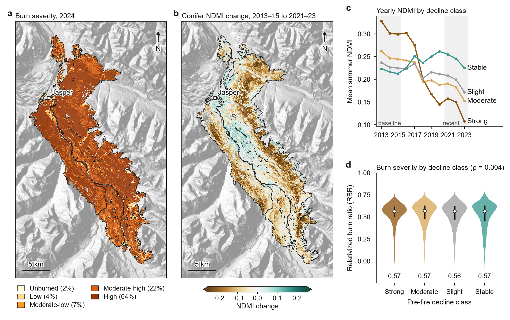
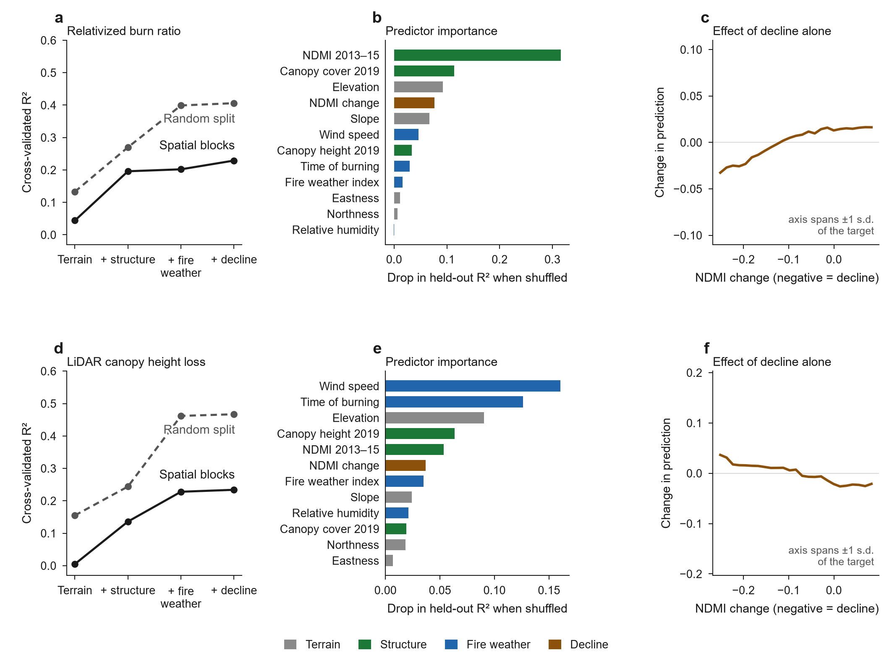
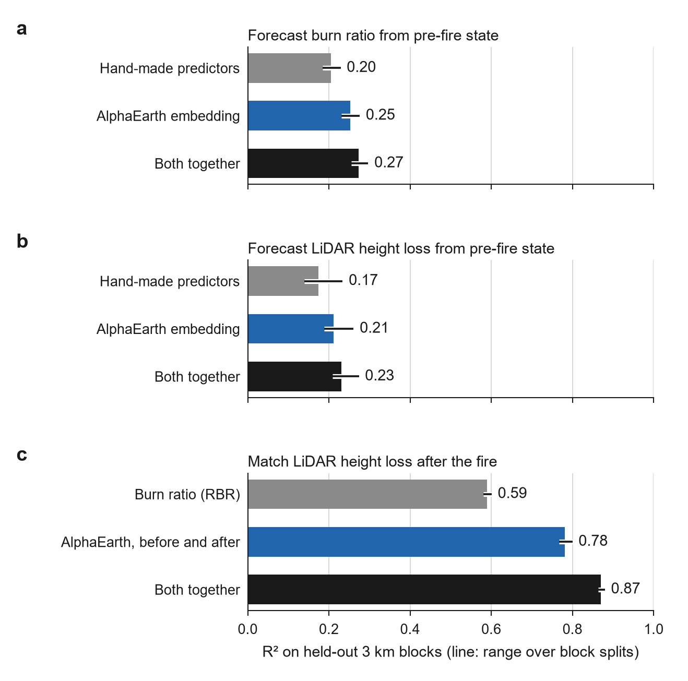
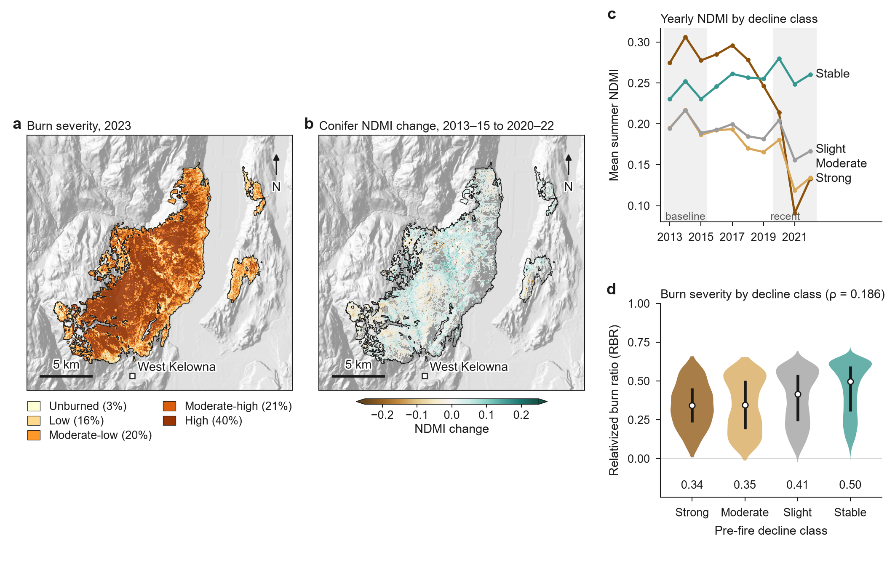
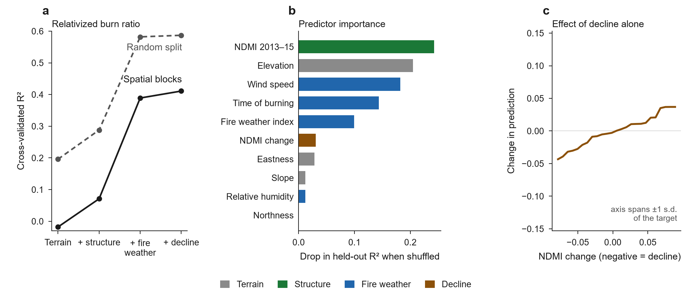
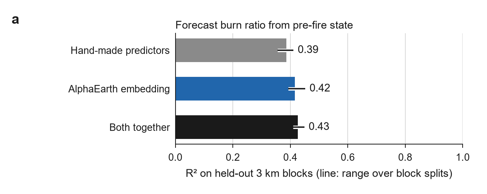

# jasper-fire-severity

Burn severity, pre-fire forest decline and canopy loss for two Canadian wildfires: Jasper 2024, and McDougall Creek 2023 in West Kelowna. Sentinel-2, Landsat, 1 m airborne LiDAR and AlphaEarth embeddings, all open data, read only where they are needed. The same code runs on both fires; what is specific to each one is a single entry in `fires.py`.

**Status: two fires done, not validated in the field.** Jasper has the full analysis, including LiDAR. McDougall Creek has everything except LiDAR, which was not flown after that fire. Neither decline map has been checked against a beetle survey.

## The question

Mountain pine beetle killed much of the lodgepole pine around Jasper in the years before the fire. Did the beetle-killed stands burn more severely than the stands that were still green? Federal reports name the dead pine as one factor in how fast the fire spread. This project looks at severity, pixel by pixel, with public data.

## What it found so far



*(a) dNBR severity classes inside the fire perimeter. (b) Change in summer NDMI of conifer forest between 2013–15 and 2021–23. (c) Mean summer NDMI per year for four classes of that change; grey bands mark the two periods compared. (d) Relativized burn ratio by class: violins show all pixels, bars the interquartile range, dots and numbers the median. Maps are drawn over shaded relief from the 30 m national terrain model. A vector copy is in `docs/jasper/figure1.pdf`.*

**1. Almost two thirds of the fire burned at high severity.**

From Sentinel-2 scenes on 2024-07-07 and 2024-09-05 at 20 m. 98.9% of the perimeter had usable pixels in both scenes. The class breaks are the generic Key and Benson values and have not been calibrated on field plots from this fire, so read the classes as a ranking.

**2. The conifer forest lost moisture sharply in 2018, six years before it burned.**

One summer NDMI image per year from Landsat 8/9, 2013 to 2023, over the 28,525 ha that the 2010 land cover maps as conifer inside the perimeter. NDMI fell by more than 0.10 on 36% of that area and by more than 0.05 on 56%. Among declining pixels where the year is known, 2018 was the year of the largest drop on 47% of the area. That timing fits the outbreak Parks Canada reported, but the map has not been checked against field data, and the 2023 values are also lower in the stands that did not decline, which points to drought that year.

**3. Stands that had declined did not burn more severely than stands that had not.**

| Pre-fire NDMI change | Area (ha) | Pre-fire NBR | dNBR | RBR | High severity |
|---|---:|---:|---:|---:|---:|
| Strong decline (below -0.10) | 10,140 | 0.31 | 0.74 | 0.57 | 69% |
| Moderate decline | 5,827 | 0.35 | 0.76 | 0.57 | 68% |
| Slight decline | 3,874 | 0.36 | 0.75 | 0.57 | 67% |
| Stable or gain (above -0.02) | 8,640 | 0.40 | 0.77 | 0.57 | 67% |

Medians per class. The rank correlation between NDMI change and RBR is 0.004 across 316,450 pixels. The declined stands started with less green canopy, so they had less to lose, yet the relative burn ratio is the same in all four groups.

This does not show that beetle kill had no effect. Most of the fire burned as a crown fire in extreme weather, so the satellite index is close to its ceiling everywhere and cannot separate degrees of "very severe". Dead pine may also have changed how fast the fire spread, which this index does not measure. And nothing here is adjusted for terrain or for the weather on the day each stand burned.

**4. LiDAR agrees with the satellite index, and also finds no difference between declined and stable stands.**


*(a) Share of the 2019 mean canopy height that was gone in October 2024, per 30 m cell, where both LiDAR surveys have data. (b) That share by dNBR severity class. (c) The same by pre-fire decline class; dashed lines are the medians in unburned conifer forest just outside the perimeter.*

Canopy height is the 1 m surface model minus the 1 m terrain model, read at full resolution for 2019 and 2024 and averaged to 30 m. Both surveys cover 66% of the fire, which leaves 16,577 ha of conifer forest to compare.

| dNBR class | Area (ha) | Median height loss |
|---|---:|---:|
| Unburned | 40 | 22% |
| Low | 196 | 30% |
| Moderate-low | 549 | 40% |
| Moderate-high | 3,399 | 72% |
| High | 12,392 | 93% |

The height loss rises step by step with the satellite class (rank correlation with RBR 0.49), so the two independent measurements tell the same story. That is a check on the dNBR classes that did not need field plots.

By decline class the median loss is 92%, 89%, 87% and 90%, from strong decline to stable, and the rank correlation with NDMI change is -0.06. So the second measure gives the same answer as the first: no meaningful difference. It also reaches a ceiling, because the fire took about 90% of the canopy height over most of the area (half of all cells lost between 77% and 96%).

Three things to keep in mind:

- A 1 m surface model sees foliage and branches much better than thin bare stems. A stand of standing burned trunks reads as a large height loss even though the trees have not fallen.
- Unburned forest next to the fire also shows a median loss of 13% between the surveys, from tree fall, a later survey date and differences in processing. Only 310 ha of it has data from both years, because the 2024 survey was flown over the burned area.
- The declined stands were the tall ones: median canopy height in 2019 was 15.5 m under strong decline and 9.7 m in stable stands. Decline class and stand structure are tangled together, which is why the next step is a model that includes both.

**5. With terrain, stand structure and fire weather accounted for, decline adds almost nothing.**



*Top row: relativized burn ratio. Bottom row: LiDAR canopy height loss. (a, d) R² of models that add one group of predictors at a time, scored on a random split and on spatial blocks. (b, e) How much the held-out score drops when one predictor is shuffled. (c, f) How the prediction moves with NDMI change alone; the vertical axis spans one standard deviation of the target either side of zero.*

Gradient-boosted models on 13,321 cells spaced 90 m apart, where both LiDAR surveys and a satellite fire detection within 1 km are available. Scores are from five-fold cross-validation over 31 blocks of 3 km, so every test cell is in a block the model never saw.

| Predictors | Burn ratio, block R² | Height loss, block R² |
|---|---:|---:|
| Terrain | 0.04 | 0.01 |
| + stand structure before the fire | 0.20 | 0.14 |
| + time of burning and fire weather | 0.20 | 0.23 |
| + pre-fire decline | 0.23 | 0.23 |

Over ten different block splits, adding decline raised R² by 0.022 on average for the burn ratio (0.009 to 0.034, positive in all ten) and by 0.006 for height loss (-0.008 to 0.017, positive in eight). The effect also points in opposite directions: stronger decline goes with a slightly lower burn ratio and a slightly higher height loss. A stand that had already lost its needles has less green for the satellite to see disappear, and more dead wood to come down, so both small effects are what the measurements would show even if the fire behaved the same.

What did matter: for the burn ratio, how green and dense the stand was before the outbreak; for height loss, the wind and the hour at which the cell burned.

Two cautions. The models explain under a quarter of the variation on land they have not seen, so most of what decided severity is not in these predictors. And scoring on a random split instead gives 0.41 and 0.47, about double, because neighbouring cells leak information between training and test.

**6. A geospatial foundation model describes the stands a little better, and sees the fire much better.**



*R² on held-out 3 km blocks, averaged over three block splits; the line on each bar is the range. (a, b) Forecasting severity from what was known before the fire. (c) Matching the LiDAR canopy height loss from satellite data alone.*

[AlphaEarth Foundations](https://developers.google.com/earth-engine/guides/aef_on_gcs_readme) summarises a year of satellite observations at every 10 m pixel as 64 numbers. I swapped those numbers in for the predictors built by hand in this project, keeping the cells, the model and the blocks the same.

| Task | Hand-made or classic | AlphaEarth | Both |
|---|---:|---:|---:|
| Forecast burn ratio from pre-fire state | 0.20 | 0.25 | 0.27 |
| Forecast LiDAR height loss from pre-fire state | 0.17 | 0.21 | 0.23 |
| Match LiDAR height loss after the fire | 0.59 (burn ratio) | 0.78 | 0.87 |

For forecasting, the 2023 embedding beats terrain, LiDAR structure and NDMI together by about 0.04, and the ranges over block splits overlap for height loss, so that is a small edge. It did not need a LiDAR flight to get there. No set of predictors forecasts more than about a quarter of the variation.

For seeing what the fire did, the difference is large. The burn ratio alone explains 59% of the variation in LiDAR height loss; the 2023 and 2024 embeddings explain 78%, and both together 87%. The embeddings draw on radar and a full year of optical data, not one image pair, which is the likely reason.

The 2023 embedding also recovers the Landsat NDMI decline with an R² of 0.78, so it already carries the information the decline map was built to capture.

Caveats: this is one fire and three block splits. The 2024 embedding mixes months before and after the fire. And the LiDAR height loss it is scored against has its own weakness with thin burned stems, described above.

## Second fire: McDougall Creek, 2023



The McDougall Creek fire burned 12,969 ha above West Kelowna in August and September 2023 and destroyed 189 structures. It is a different forest from Jasper: drier Douglas-fir and pine in the Okanagan, logged for decades, with no recent beetle outbreak on the scale of Jasper's. The point of running it was to see what of the Jasper workflow and results carries over.

**The decline map picks up logging, not just dying trees.** On the first run, 75% of the strongest-decline area sat inside cutblocks that BC's consolidated cutblocks layer records as harvested between 2013 and 2022. A clearcut drops NDMI as sharply as a beetle kill. Jasper is a national park with no logging, so this never showed there. The workflow now drops land harvested during the record when a fire is in BC (451 ha here). After that, only 5% of the conifer forest declined by more than 0.05, against 56% at Jasper; most of what is left is a dip in 2021, the summer of the heat dome.

**Declined stands burned less, not more**, as at Jasper. Median burn ratio ran from 0.34 in the strongest-decline class to 0.50 in stable forest. The declined stands also had less green canopy before the fire (pre-fire NBR 0.32 against 0.47), which is the same measurement effect described above.



**Fire weather decided far more of the severity here.** Adding the time of burning and the weather lifted the block-validated R² from 0.07 to 0.39; at Jasper it added almost nothing to the burn ratio model. About 80% of the analysed cells were first detected burning between the evening of 17 August and the next afternoon, local time, after a cold front drove the fire downhill toward the lake. A model can only do so much with a day like that.

**Decline still added little**: 0.017 R² on average over ten block splits (0.003 to 0.029). Before the cutblocks were taken out, the same test gave 0.048, so about two thirds of that apparent effect was logging.



**AlphaEarth again forecasts a little better than the hand-made predictors**: 0.42 against 0.39, with ranges that overlap. It recovers the NDMI decline much less well than at Jasper (R² 0.27 against 0.78), which fits a forest where there was little decline to find.

### What carried over between the two fires

| | Jasper 2024 | McDougall Creek 2023 |
|---|---:|---:|
| Area (ha) | 31,645 | 12,969 |
| High severity share (dNBR) | 64% | 40% |
| Conifer with NDMI decline above 0.05 | 56% | 5% |
| Median RBR, strongest decline class vs stable | 0.57 vs 0.57 | 0.34 vs 0.50 |
| Block R², full model, burn ratio | 0.23 | 0.41 |
| R² gained by adding decline | 0.022 | 0.017 |
| Random-split R², same model | 0.41 | 0.59 |
| AlphaEarth vs hand-made, block R² | 0.25 vs 0.20 | 0.42 vs 0.39 |

Held in both: decline added at most about 0.02 R² once other predictors were in, declined stands never burned more severely, AlphaEarth edged out the hand-made predictors, and a random split scored roughly 0.2 higher than spatial blocks. Not held: which predictors mattered (stand condition at Jasper, fire weather at McDougall Creek), and whether the decline map means beetles at all.

Two fires are still two cases. McDougall Creek had too little decline to be a strong test of the beetle question; what it does test is whether the workflow transfers, and it showed one place where it did not until fixed.

## Run it

```bash
pip install -e ".[dev]"
# every step takes --fire jasper (the default) or --fire mcdougall
jasperfire perimeter      # fire perimeter from the National Burned Area Composite
jasperfire dnbr           # dNBR, RBR and severity classes as GeoTIFFs in out/jasper/
jasperfire beetle         # yearly Landsat NDMI and the change map (about 8 minutes)
jasperfire compare        # severity by decline class
jasperfire canopy-loss    # LiDAR canopy height loss for the whole fire (about 6 minutes)
jasperfire model          # nested models with spatial block validation (about 4 minutes)
jasperfire embeddings     # hand-made predictors against AlphaEarth embeddings (about 4 minutes)
jasperfire figures        # the figures above, into docs/jasper/
jasperfire canopy --lon -118.0989 --lat 52.8466    # LiDAR canopy cover in one 500 m window
```

What is specific to one fire (dates, perimeter, land cover, terrain, the years compared) lives in `src/jasperfire/fires.py`, and every step takes `--fire <key>`. Jasper is the only entry so far.

Every step reads only the window it needs from cloud-hosted files. Nothing large is stored apart from the burned-area shapefiles, though `canopy-loss` streams several gigabytes of LiDAR.

## Data

| Data | Source | Resolution | Checked |
|---|---|---|---|
| Fire perimeter | National Burned Area Composite 2024, fire `2024_451`, 31,645 ha | vector | yes |
| Optical imagery | Sentinel-2 L2A on Earth Search (STAC, cloud-optimized GeoTIFF) | 10–20 m | yes |
| LiDAR before the fire | CanElevation HRDEM, Jasper Park 2019 | 1 m | yes |
| LiDAR after the fire | CanElevation HRDEM, Jasper 2024 and Jasper 2025 | 1 m | yes |
| Pre-fire decline | Landsat 8/9 Collection 2 Level-2 on the Planetary Computer, 2013–2023 | 30 m | yes |
| Conifer mask | Land Cover of Canada, 2010 edition | 30 m | yes |
| Earlier fires | National Burned Area Composite, 2013–2023 (4.6 ha inside the perimeter) | vector | yes |
| Terrain | MRDEM 30 m terrain model (CanElevation) | 30 m | yes |
| Fire detections | CWFIS hotspots 2024 (VIIRS), with interpolated fire weather | 375 m | yes |
| Foundation model embeddings | AlphaEarth Foundations Satellite Embedding, 2023 and 2024, Source Cooperative copy | 10 m | yes |
| McDougall Creek perimeter | National Burned Area Composite 2023, fire `2023_834`, 12,969 ha | vector | yes |
| Harvest history (BC) | BC consolidated cutblocks, from the province's open WFS | vector | yes |
| Beetle survey | No open spatial layer found for inside the park | – | no |

Alberta publishes its beetle aerial surveys for provincial land, not for the national park, so the decline map here stands in for a survey layer. Checking it against Parks Canada's own survey data is still to do.

No open sub-metre imagery of this fire was found. Maxar's open data programme released imagery for the 2023 Kelowna and Northwest Territories fires and the 2025 Los Angeles fires, but not for Jasper. The 1 m LiDAR fills that gap here.

## Next

1. Ask Parks Canada for the beetle survey polygons and check the Jasper decline map against them.
2. Add a third fire with a real beetle history outside a park, to test the beetle question in a working forest.
3. Follow early regrowth at Jasper with the 2025 LiDAR and the 2025–2026 imagery.
4. Rate of spread needs a fire with a long, well-observed progression; neither of these has one.

## Tests

```bash
ruff check .
pytest -q
```

The 37 tests run offline. They cover the index maths, reflectance scaling, cloud masking, yearly compositing, scene choice, canopy height and cover per cell, slope and aspect, matching cells to fire detections, the block split and the comparison table.

## Credits

Contains information licensed under the Open Government Licence – Canada (NBAC, CWFIS hotspots, CanElevation, MRDEM, Land Cover of Canada), modified Copernicus Sentinel data, and Landsat data from the U.S. Geological Survey. The AlphaEarth Foundations Satellite Embedding dataset is produced by Google and Google DeepMind.
